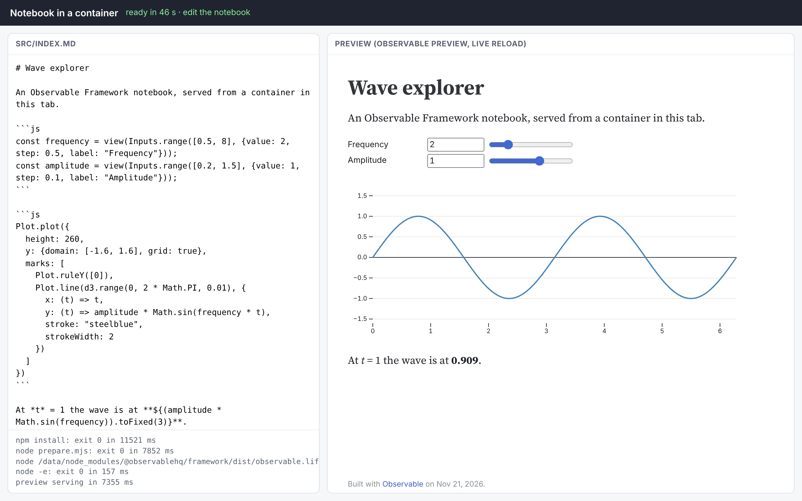
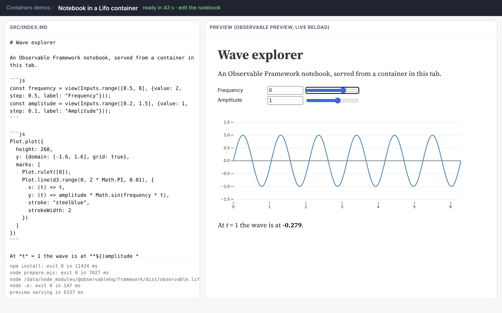
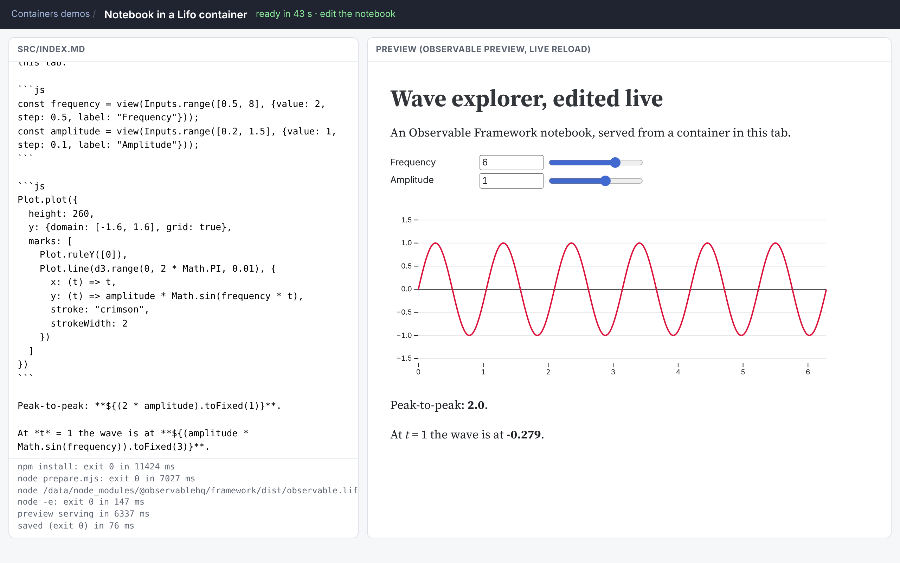

# Observable Framework in containers

[Observable Framework](https://observablehq.com/framework/) installs and builds sites in Lifo
containers, in Node and in Chromium, as [layers](layered-files.md): one build step with egress
installs Framework into a FilesApi, and site builds run on that layer, read-only, with no network.
This is for sites you trust (your own notebooks): Lifo's no-network rule is a guard for cooperative
code, not a sandbox ([Isolation](../README.md#isolation)).

Tested in `test/observable-framework.test.ts` (Node) and `e2e-browser/layers.spec.ts` (Chromium),
with the recipe in [`examples/observable-framework/recipe.ts`](../examples/observable-framework/recipe.ts).
Both need the npm registry and jsDelivr for the build step.

## The flow

```ts
import { frameworkBuild, frameworkBuildSteps, frameworkLayerFiles } from "./examples/observable-framework/recipe.ts";

// 1. the layer: package.json and the adaptation, then the build steps, in a container with egress
const layer = new MemFilesApi();
for (const [path, content] of Object.entries(frameworkLayerFiles("/data"))) await writeText(layer, `/${path}`, content);
const build = createIsolatedPool({ spawn: lifoWorkerWithEgress, image: { packages: [], enableInternet: true, env }, size: 1 });
for (const argv of frameworkBuildSteps("/data")) await build.run({ argv, files: layer, cwd: "/data" });
await build.close();

// 2. a site: its sources in a layer of its own, over the read-only base; no network
const site = new MemFilesApi();
await writeText(site, "/src/index.md", "# Hello\n");
await runs.run({ argv: frameworkBuild("/data"), files: cow(readOnly(layer), site), cwd: "/data" });
// site now holds dist/index.html and the rest of the built site; the base is unchanged
```

The build steps are `npm install`, `node prepare.mjs` (adapts the CLI, below) and one build of a
placeholder page that fills Framework's npm cache (`src/.observablehq/cache`), which is then
removed. Framework downloads its client's npm modules (`npm:d3`, `npm:@observablehq/plot`, ...)
during a build and resolves their versions from that cache first, so site builds need no network.
A site that imports a module the cache does not have fails without network (tested): add it to
the placeholder page, or give that build egress.

| | Node 24 | Chromium |
| --- | --- | --- |
| `npm install` (260 packages, into the layer's FilesApi) | 7.3 s | 8.5 s |
| adapting the CLI | 1.4 s | 5.8 s |
| filling the npm cache (a placeholder build) | 4.9 s | 6.0 s |
| a site build without network | ~5.0 s | ~6.2 s |

## Adapting Framework to Lifo

Framework 1.13.4's CLI does not run in Lifo as published. `prepare.mjs` bundles it with esbuild
into `dist/observable.lifo.mjs`, working around:

- **Lifo's ESM loader** mis-parses some dependencies (a comment inside an export list in
  `get-east-asian-width`): the bundle avoids the loader.
- **Missing built-ins:** `node:path/posix` (Lifo's `path` is POSIX already),
  `node:timers/promises`, `util.parseArgs` (from `@pkgjs/parseargs`) and `util.deprecate`: shims.
- **Packages that find files next to themselves** stay outside the bundle: `jsdom` (its XHR worker
  script), `esbuild` (Lifo's own) and `rollup` (as `@rollup/wasm-node`: Lifo cannot load native
  addons). `css-tree` reads `../data/patch.json` relative to its file, now the bundle: the file is
  copied next to it.
- **Lifo's esbuild** resolves every import through its own VFS plugin: it ignores `external`, and
  resolves a cwd-relative alias or entry point as a package. A wrapper turns Framework's style
  aliases into a plugin and makes its entry points absolute (`inputs.css`, when a page uses
  Inputs). In browsers it is esbuild-wasm, which has no filesystem to fall back on: an import Lifo
  cannot resolve fails the build (debug's optional `supports-color` is kept external).
- **Lifo's `import()`** keeps a query string in the path, and Framework imports its config file
  with a cache-busting query: no `observablehq.config.js`; the defaults apply (`root: "src"`).

## Preview with live reload

`observable preview` runs in a container and live reload works, in Node and in Chromium (tested in
both). Framework's server keeps a WebSocket per open page (`/_observablehq`): the page says which
page it shows (`hello`), and the server pushes an `update` when the page's file changes.

```ts
import { containerWebSocket } from "@statewalker/cellb-containers";
import { frameworkPreview } from "./examples/observable-framework/recipe.ts";

const c = createContainer(lifoEngine, {
  packages: [],
  mounts: [{ path: "/data", id: mounts.add(cow(readOnly(layer), site)) }],
  workdir: "/data",
});
await c.start({ entrypoint: frameworkPreview("/data", 3000) });
await c.waitForPort(3000);

const html = await (await c.getTcpPort(3000).fetch("http://container/")).text();
const WS = containerWebSocket(c, 3000); // a WHATWG WebSocket class into the container
const ws = new WS("ws://container/_observablehq");
ws.onopen = () => ws.send(JSON.stringify({ type: "hello", path: "/", hash })); // hash: from the page
ws.onmessage = (e) => console.log(JSON.parse(e.data).type); // "welcome", then "update" on edits
```

In Chromium the preview served pages 6.0 s after `start()`, and the `update` arrived 80 ms after
the edit (Node: tested, not timed).

What it took:

- **`ws` resolved to its Node entry** in the CLI bundle. Lifo's esbuild picked the package's
  `browser` export, a stub without `WebSocketServer`. Lifo's `node:http` server already emits
  `upgrade` events, so `ws` works unchanged on top of them.
- **WebSockets through the container's port.** `getTcpPort(port).fetch()` of an upgrade request
  answers 101 and carries the socket's `MessagePort`, using the convention of
  `@statewalker/webrun-http-browser` (`newWebSocketUpgradeRequest`, `takeUpgrade`); it crosses the
  engine RPC like any other port. The Lifo engine bridges it to the server in the box (Lifo's
  `box.connect()`). `containerWebSocket(container, port)` wraps it in that package's
  `createWebSocketClass`: the browser's `WebSocket` API.
- **The server as the entrypoint.** Lifo runs one command at a time, so a server started with
  `exec()` would block every later command. The entrypoint runs as a background job instead, in
  the image's `workdir` (new in `ContainerSpec`: Docker's `WORKDIR`).

Framework watches files with `fs.watch`, which Lifo implements for writes made inside the box:
an edit through a command in the container is seen, through the mount included. A write to the
FilesApi from outside the container is not (the FilesApi has no change events): it shows on the
next request, without a push.

## An interactive notebook in the browser

[`examples/browser-demos`](../examples/browser-demos) (its `notebook/` page, live at
[containers.cellb.dev/notebook/](https://containers.cellb.dev/notebook/)) puts it
together in one tab: an editor, and Framework's preview in a frame, served from a Lifo container
with no network through webrun-http-browser's ServiceWorker, with live reload. Tested by
`e2e-browser/demos.spec.ts`, which takes these screenshots in Chromium.

The notebook, served from the container (about 40 s from a cold start, the layer's build included):



Moving a slider re-runs the cells that depend on it, in the frame:



An edit in the editor is written into the container; Framework pushes the change, and the frame
updates in place (the same document, the slider still at 6):



## In Wasmer (edgejs): blocked

`wasmer/edgejs` installs Framework (in about 37 s, with `node-linker=hoisted` and esbuild/rollup replaced by
their wasm builds) but cannot run it: edgejs does not keep live bindings across cyclic ES module
imports (a module sees `undefined` for a function exported by a module that imports it back;
reproduced with two plain modules), and Framework's sources have such cycles. Bundling the CLI
inside edgejs with esbuild-wasm crashed the Wasmer worker (`WORKER_FAILED`). Both are upstream
issues.
