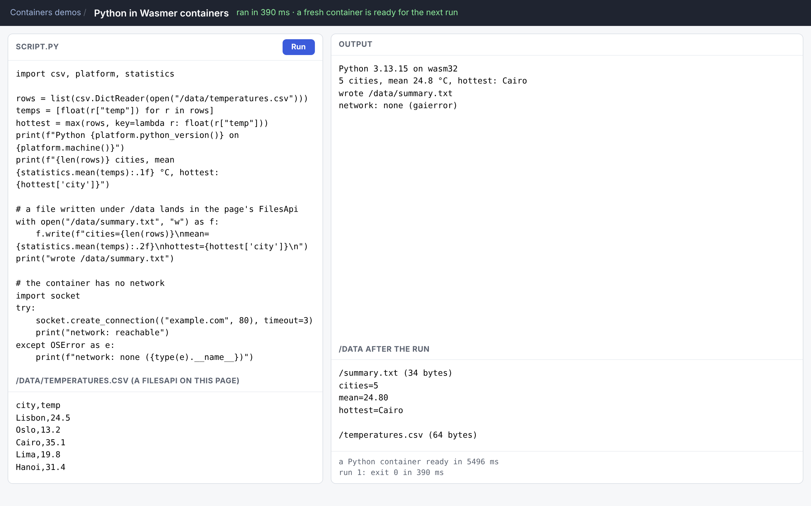
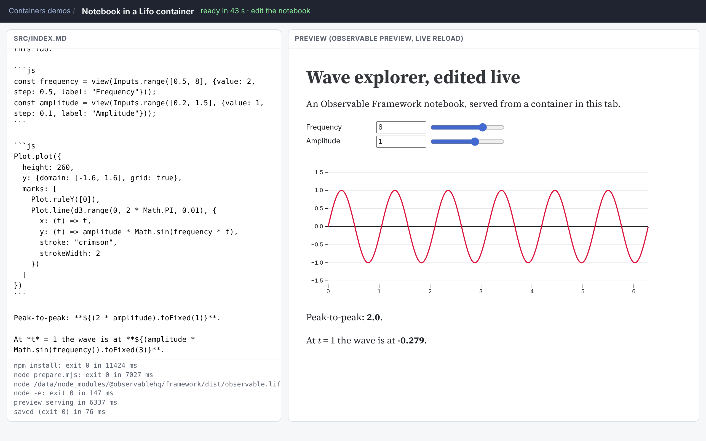

# Containers in a browser tab

Two live demos of `@statewalker/cellb-containers`, one per engine, served as static sites:
the Wasmer one at [cellb.dev/demos/containers/](https://cellb.dev/demos/containers/), the Lifo one
at [containers.cellb.dev](https://containers.cellb.dev/), an origin of its own
(see [Where they are published](#where-they-are-published)).

| Demo | Engine | What it shows |
| --- | --- | --- |
| [Python in Wasmer containers](https://cellb.dev/demos/containers/python/) (`python/`) | Wasmer (WASIX sandboxes) | a script runs in a fresh Python container per run, against files from the page, with no network |
| [Notebook in a Lifo container](https://containers.cellb.dev/notebook/) (`notebook/`) | Lifo (a Linux-like OS in TypeScript) | Observable Framework installed by `npm` in the tab, then `observable preview` with live reload |





```bash
pnpm --filter @statewalker/cellb-containers exec vite --config examples/browser-demos/vite.config.ts
```

Open the printed URL in Chrome or another Chromium-based browser (tested there; both demos need
cross-origin isolation, which the dev server and, on a static host, the ServiceWorker provide).
`vite build --config examples/browser-demos/vite.config.ts` builds the static site (`DEMOS_BASE`,
`DEMOS_PAGES` and `DEMOS_NOTEBOOK_HREF` set where it is served, which demos it holds, and where
the landing page links the notebook).

## Python in Wasmer containers (`python/`)

1. **An isolated pool** (`createIsolatedPool`) keeps one Python container ready, each in a Web Worker
   of its own (`wasmer-worker.ts`: a Wasmer client with `python/python` from the Wasmer registry),
   warmed with `python -c pass` so the first run starts hot.
2. **A run** takes the ready container, mounts that run's FilesApi (a `MemFilesApi` on the page,
   holding `temperatures.csv`) at `/data`, runs `python -c <script>` with a timeout, and terminates
   the worker. A new container is prepared meanwhile, so the next run starts in about 0.4 s.
3. What the script writes under `/data` lands in the page's FilesApi; nothing else of the page is
   visible, there is no network (`socket` fails with `gaierror`), and nothing of a run (its `/tmp`,
   its memory) reaches the next one: the demo's test checks all three.
4. Wasmer's SDK is served unbundled at `<base>wasmer-sdk/` (its thread-pool workers import their
   sibling files by URL, which a bundler does not follow); the worker imports it from there.

Wasmer is the isolation boundary: this is where code you do not trust belongs.

## Notebook in a Lifo container (`notebook/`)

An interactive [Observable Framework](https://observablehq.com/framework/) notebook, edited and
previewed in the tab: `observable preview` runs in a Lifo container with no network, and live
reload pushes every edit to the preview without reloading it.

1. **The layer** ([`../observable-framework/recipe.ts`](../observable-framework/recipe.ts)): a Lifo
   container with egress (`build-worker.ts`, the page's network) installs Framework into a FilesApi
   on the page, adapts its CLI to Lifo and fills its npm cache with what the notebook imports
   (Plot, d3, Inputs).
2. **The notebook's container** (`run-worker.ts`): no network, the layer mounted read-only under the
   notebook's own layer (`cow`), `observable preview` as its entrypoint, `workdir: "/data"`.
3. **The preview frame** loads `<base>nb/…`. The ServiceWorker routes those requests to a handler
   on the page, which forwards them to `container.getTcpPort(3000).fetch()`.
4. **Live reload.** A ServiceWorker cannot answer WebSockets, so the handler adds a script to each
   HTML page that gives the frame the page's `containerWebSocket(container, 3000)`; it also drops
   the `<base>nb` prefix from the path the client reports. Framework's own client then talks to the
   server in the container.
5. **Edits** are written into the container (`container.exec`), where Framework's file watcher
   sees them and sends an `update`: the frame patches the changed blocks, and the inputs keep their
   values.

Lifo is not a security boundary (guest JS runs in its worker's realm): the notebook is code you
trust, and the no-network rule is a guard for it, not a sandbox. Its build step installs npm
packages (with their dependencies, resolved on each visit) and runs them in the page's realm, and
the preview frame runs Framework's client and the npm modules it loads: all of that code has the
rights of the page's origin. That is why this demo has an origin of its own.

## Where they are published

| Demo | Where | Published by |
| --- | --- | --- |
| landing page and `python/` | `https://cellb.dev/demos/containers/` | the site (`site/scripts/build-containers-demos.mjs`, `DEMOS_PAGES=python`), on every site deploy |
| landing page, `python/` and `notebook/` | `https://containers.cellb.dev/` | `.github/workflows/examples-publish.yml` (run by hand), after testing the build |

The Python demo can share cellb.dev's origin: its page runs this repository's code only, and the
Python a visitor types runs inside Wasmer's sandbox, which has no access to the page's JavaScript.
The notebook cannot (above): code from npm would have the rights of cellb.dev, whose other pages
keep data in the browser (the sandbox can remember an API key).

## The ServiceWorker

`sw-worker.js` (built by `vite.config.ts`, scope: the app's base path) is
`@statewalker/webrun-http-browser`'s runtime inside a shim that gives every page of its scope
cross-origin isolation (COOP `same-origin`, COEP `credentialless`): a static host sends no such
headers, and both engines need `SharedArrayBuffer`. A page's first visit reloads once to be
controlled by it (`service-worker.ts`).

## Tests

- `e2e-browser/demos.spec.ts`: both demos from the dev server (`UPDATE_SCREENSHOTS=1` retakes the
  screenshots in `docs/images/`).
- `site/scripts/check-containers.mjs` (`pnpm --filter @statewalker/cellb-site check:containers`):
  a build served by a plain file server with no COOP/COEP headers, as published: the site's copy
  (python) in the site workflow, the whole build in `examples-publish.yml` before it is published.
