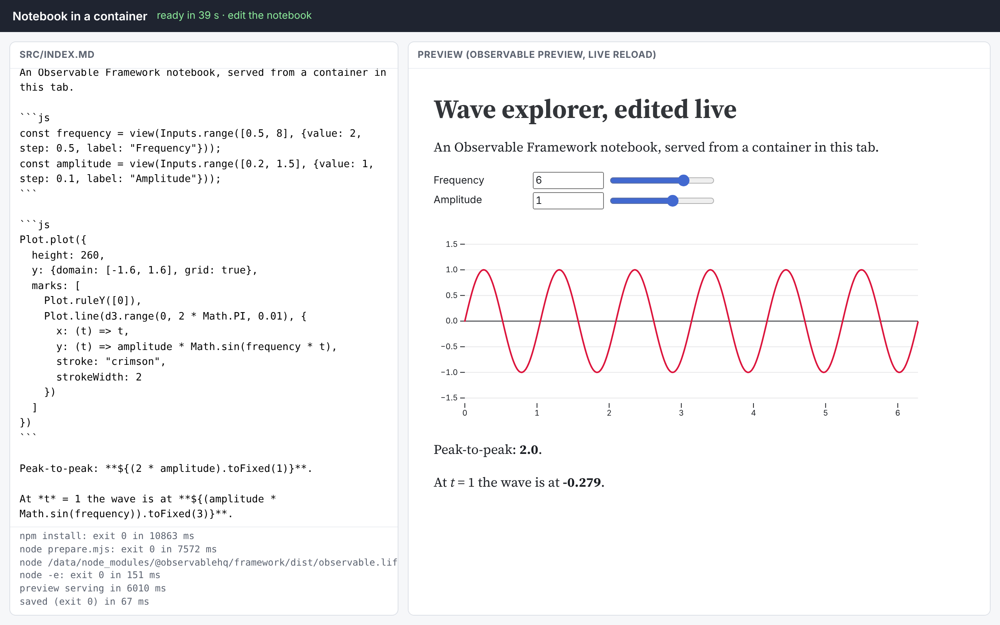

# Notebook in a container

An interactive [Observable Framework](https://observablehq.com/framework/) notebook, edited and
previewed in the browser tab: `observable preview` runs in a Lifo container with no network, and
live reload pushes every edit to the preview without reloading it.



```bash
pnpm --filter @statewalker/cellb-containers exec vite --config examples/observable-framework/notebook/vite.config.ts
```

Open the printed URL in Chromium. The first start builds Framework's layer (about 30 s), then
the preview starts (about 6 s). Edit the notebook on the left.

## How it works

1. **The layer** ([`../recipe.ts`](../recipe.ts)): a Lifo container with egress
   (`build-worker.ts`, the page's network) installs Framework into a FilesApi on the page, adapts
   its CLI to Lifo and fills its npm cache with what the notebook imports (Plot, d3, Inputs).
2. **The notebook's container** (`run-worker.ts`): no network, the layer mounted read-only under
   the notebook's own layer (`cow`), `observable preview` as its entrypoint, `workdir: "/data"`.
3. **The preview frame** loads `/nb/…`. webrun-http-browser's ServiceWorker (`/sw-worker.js`)
   routes those requests to a handler on the page, which forwards them to
   `container.getTcpPort(3000).fetch()`.
4. **Live reload.** A ServiceWorker cannot answer WebSockets, so the handler adds a script to each
   HTML page that gives the frame the page's `containerWebSocket(container, 3000)`; it also drops
   the `/nb` prefix from the path the client reports. Framework's own client then talks to the
   server in the container.
5. **Edits** are written into the container (`container.exec`), where Framework's file watcher
   sees them and sends an `update`: the frame patches the changed blocks, and the inputs keep their
   values.

Tested by `e2e-browser/notebook.spec.ts`, which takes the screenshots in `docs/images/`.
